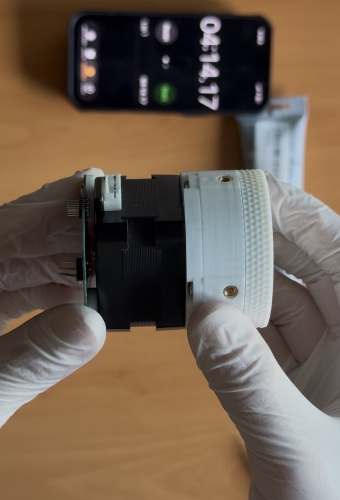

# HDP30: a 3D-printable 30:1 pancake harmonic drive actuator

A strain-wave (harmonic) gearbox that bolts onto a standard NEMA 17 stepper,
prints on a bog-standard bed slinger, and costs about **$4 of hardware** per
unit. Half again the reduction of our [HD20](https://github.com/robrotics/hd20)
in a thinner package, using the same screws, the same bearing and the same
motor face.



| | |
|---|---|
| **Reduction** | 30:1 |
| **Tooth profile** | Cycloidal, module 0.55, 60-tooth flexspline / 62-tooth circular spline |
| **Measured torque** | Held **1.49 N·m** with no tooth skips. **Cracking starts at about 1.5 N·m**, and the flexspline wall broke at about 2.0 N·m. See [Test data](#test-data) |
| **Efficiency** | 47-60% static (stalled against a load cell) |
| **Backlash** | Too small to measure on our rig: under 0.25° at the output |
| **Torsional stiffness** | 40 N·m/rad at 0.85 N·m, rising to 61 N·m/rad at 1.5 N·m |
| **Motor** | Any NEMA 17 with a 5 mm shaft (same interface plate as the HD20) |
| **Lubrication** | Super Lube synthetic PTFE grease |
| **Printed parts** | 11 pieces across 9 unique parts, including 3 shear pins, plus a printed alignment tool |
| **Materials** | PLA throughout, **including the flexspline** |
| **Fasteners** | 8 × M3×0.5 × 6 mm button head screws per drive |
| **Hardware cost** | ~$3.96 per actuator |
| **Version** | v2.0 (RevC, 2026-10-18) |
| **License** | [CC BY-SA 4.0](LICENSE) |

> ⚠️ **Treat 1.5 N·m as the ceiling, not a working load.** On the load cell,
> RevC held 1.49 N·m without skipping a tooth, which is past the point where
> v1.0 started ratcheting. But at about 1.5 N·m (15 N on our 100 mm test
> arm) we started hearing the flexspline crack, and at about 2.0 N·m the
> flexspline wall broke. Set your motor current so the drive can't get there.
>
> ⚠️ **The PLA flexspline has not been fatigue tested.** It flexes twice on
> every turn of the motor. It survived our load-cell runs, but we haven't run
> it for hours yet, and PLA is more brittle than the PETG we used before. If
> you run one for a long time, please
> [open an issue](https://github.com/robrotics/hdp30/issues) and tell us how
> it held up. We'll credit you.

---

## How it works

Three parts do the work. A **wave generator**, an ellipse riding on 11 loose
5 mm balls in a printed cage, pushes a flexible toothed ring (the
**flexspline**) into an oval, so its teeth engage a rigid ring (the **circular
spline**) at just two points. The circular spline has two more teeth than the
flexspline, so one turn of the motor walks the output around by two teeth.
With a 60-tooth flexspline, that tiny slip per revolution is the 30:1.

New to strain-wave gearing? We wrote a plain-language explainer:
**[robrotics.web.app/learn](https://robrotics.web.app/learn)**.

## What changed from v1.0 (RevB)

v1.0 held 1.47 N·m and then started **ratcheting**: the flexspline teeth rode
over the circular spline one tooth at a time, and every round of that left the
drive weaker. RevC goes after that with two changes:

- **The flexspline is now PLA instead of PETG.** Same geometry, stiffer
  material. It also creeps about half as much under a steady load.
- **The flexspline lines up better with the circular splines.** A new printed
  **alignment tool** sets the wave generator at the right height on the motor
  shaft, so the flexspline teeth sit square in both circular splines. Both
  circular splines were also re-cut to take a **third shear pin**.

The result on the load cell: no tooth skips up to 1.49 N·m, about 40% less
twist at the same torque, and the same efficiency. The tooth profile, the
wave generator, the cage, the interface and both preloaders are unchanged
from v1.0, and so is every piece of hardware.

We changed two things at once, so we can't fully split the credit. The way the
stiffness rises with load points at the alignment, and the lower creep points
at the PLA.

## What changed from the HD20

The HD20 got 20:1 out of a 40-tooth flexspline at module 0.8. The HDP30 keeps
the same two-tooth difference but packs in **60 teeth at module 0.55**, which
buys half again the reduction at roughly the same pitch diameter, and lets the
whole stack get thinner, hence *pancake*.

The interface plate, the base preloader and every piece of hardware are the
same as the HD20's: same 11 balls, same 30×42×7 bearing, same 8 screws, same
12 inserts. If you have already built an HD20, your leftovers cover this one.

The HD20 is still the stronger drive. It was tested to 3.3 N·m.

## What you need

**Not included in the BOM, bring your own:**

- A **NEMA 17 stepper with a 5 mm shaft**. The interface plate is unchanged
  from the HD20, which was validated with an
  [OMC StepperOnline 17HE12-1204S](https://www.omc-stepperonline.com/e-series-nema-17-bipolar-26ncm-36-82oz-in-1-2a-42x42x30mm-4-wires-w-1m-cable-connector-17he12-1204s)
  (42 × 42 × 30 mm, 26 N·cm, 1.2 A, 4-wire) under closed-loop FOC control.
- **4 × M3 screws** to bolt the motor to the interface plate. These are
  separate from the 8 × M3×0.5 × 6 mm screws that hold the drive together,
  which are in the BOM.
- A **soldering iron** for the heat-set inserts, and hex keys.

**Filament:** PLA for everything, including the flexspline.

> **Building v1.0?** Its flexspline is still PETG. The PLA advice only
> applies to the RevC geometry and alignment. v1.0's files and instructions
> are on the [`v1.0` tag](https://github.com/robrotics/hdp30/tree/v1.0).

## Bill of materials

Machine-readable source: [`bom.json`](bom.json). Unchanged from v1.0.

| # | Item | Qty | Pack | Pack cost | Per actuator |
|---|------|-----|------|-----------|--------------|
| 1 | M3 heat-set inserts | 12 | 100 | $9.99 | $1.20 |
| 2 | M3×0.5 × 6 mm button head, stainless | 8 | 100 | $7.69 | $0.62 |
| 3 | 30 × 42 × 7 mm bearing | 1 | 10 | $16.39 | $1.64 |
| 4 | Set screw | 1 | 50 | $5.69 | $0.11 |
| 5 | 5 mm steel bearing balls | 11 | 200 | $7.20 | $0.40 |
| 6 | Super Lube synthetic grease | 1 | - | - | - |
| | | | | **$46.96 buy-in** | **$3.96 each** |

One tube of grease lasts many builds, so it isn't counted in the per-unit cost.

Parts are sold in packs, so the first actuator costs about $47 in hardware and
every one after that costs about $4, and you'll have enough left over for
eight more.

> **Affiliate disclosure:** the purchase links in `bom.json` and on our website
> are Amazon Associates links. If you buy through one, Robrotics earns a small
> commission at no extra cost to you. Every part listed is what we actually
> used; the links don't change the recommendation.

## Printed parts

| Part | Qty | Material | File |
|---|---|---|---|
| Circular spline (base) | 1 | PLA | `hdp30-circular-spline-base` |
| Circular spline (output) | 1 | PLA | `hdp30-circular-spline-output` |
| Base preloader | 1 | PLA | `hdp30-base-preloader` |
| Output preloader | 1 | PLA | `hdp30-output-preloader` |
| Interface / motor mount | 1 | PLA | `hdp30-interface` |
| Wave generator | 1 | PLA | `hdp30-wave-generator` |
| Ball cage | 1 | PLA | `hdp30-cage` |
| Flexspline | 1 | PLA | `hdp30-flexspline` |
| Shear pin | **3** | PLA | `hdp30-shear-pin` |
| Alignment tool (assembly jig) | 1 | PLA | `hdp30-alignment-tool` |

**All three shear pins are required**, and they're the same part printed three
times, so there's only one file. They carry shear load across the output joint
directly, so the connection doesn't have to rely on friction from the
preloaded screws to resist it. The screws clamp; the pins take the sideways
load.

### Print settings

The HD20 was printed on a **Bambu Lab P1S** with **Bambu PLA**, and the HDP30
uses the same settings:

- **Arachne** variable-width wall generator
- **One extra wall loop** for strength
- **Seam position: random**, on every part, so a single seam line doesn't stack
  up into a weak spot or a visible ridge on the round surfaces
- **Supports on the output circular spline and the interface.** Everything else
  prints unsupported.

No custom temperatures, no special bed prep.

## Files

```
cad/step/          STEP, for slicing and for CAD work
cad/dxf/           The four tooth profiles, straight out of the harmonic maker
photos/            Build photos
bom.json           Bill of materials (source of truth)
```

Grab the packaged bundles from the
[Releases page](https://github.com/robrotics/hdp30/releases) rather than
cloning, because the STEP files are large. The v1.0 (RevB) bundles are still
there too.

There are no pre-sliced files in the repo. Import the STEP into your slicer and
use the print settings above, so the geometry you print is always the current
one.

## Assembly

**New in RevC: the alignment tool.** Before you tighten the set screw on the
wave generator, sit the alignment tool on top of the interface plate and slide
the wave generator down the motor shaft onto it. That puts the wave generator
at the right height, so the flexspline lines up with both circular splines.
Tighten the set screw, then take the tool out.

📹 **Quick assembly run-through (v1.0):**
**[instagram.com/reel/DclcvVig55a](https://www.instagram.com/reel/DclcvVig55a/)**

That one is fast, and it predates the alignment tool. A full, properly paced
build video is in the works and will go up on
[youtube.com/@robrotics](https://www.youtube.com/@robrotics) and be linked
here. Written step-by-step instructions are being put together alongside it.

## Make your own version

Two ways in, depending on how deep you want to go.

**Change the tooth profile.** Every profile in this drive came out of our own
free generator, the [harmonic maker](https://robrotics.web.app/gearmaker).
This link opens it with the exact settings used for the HDP30, so you can nudge
one number and export a new DXF:

**[Open the HDP30 profile in the harmonic maker →](https://robrotics.web.app/gearmaker?style=pancake&profile=cycloid&tol=0.01&wave=1&fit=1&module=0.55&zf=60&zc=62&w0Ratio=1.0&ha=1.08&hd=1.08&toothThickness=0.50&toothAngle=9.17&tipHalfWidth=0.30&rootFillet=0.15&clearance=0&clearanceOutput=-0.05&pressureAngle=30&wallFlex=0.75&wallCirc=3.0&wallDyn=3.0)**

The four DXFs it produces are checked into [`cad/dxf/`](cad/dxf) if you'd
rather start from ours. They didn't change in RevC.

**Change the mechanics.** The full parametric model is public on Onshape:

**[Open the HDP30 in Onshape →](https://cad.onshape.com/documents/00aa260f74512dcff2b213b4/w/4c680e785500c7d99b4aee16/e/b8bea9465cf012505d76df17?renderMode=0&uiState=6ad52310278c59d60d73b0f3)**

Copy it to your own workspace and change what you like: a different motor face,
a different output interface, a different ratio. If you build a variant, we'd
genuinely like to see it: open an issue or tag
[@robrotics](https://www.instagram.com/robrotics).

## Known behaviour

**Measured on this drive:**

- **Cracking starts at about 1.5 N·m.** Past that, the PLA flexspline wall
  cracks, and it broke outright at about 2.0 N·m. We never saw RevC ratchet,
  so don't count on v1.0's buzzing as a warning. Limit the motor current.
- **It twists, but it doesn't rattle.** Expect about 1° of elastic twist at
  the output at 0.85 N·m, and about 1.6° at 1.5 N·m. That's give, not slack.
- **Torque relaxes a little under a steady hold.** With the motor held still,
  output torque dropped about 5% over two seconds and then levelled off.

**Carried over from the HD20:**

- **PLA creeps under sustained load.** Holding a heavy static load for hours
  will slowly deform the splines, and that now includes the flexspline.
- **Unit-to-unit variation is real.** Two HD20s of the same design differed by
  up to 18% at the same current. Printed gearboxes are not precision parts.
- **Output spline preload is the biggest tuning knob.** On the HD20, tightening
  it further took one unit from 2.37 to 2.55 N·m. Expect it to matter here too.

**Not yet known for this drive:** fatigue life of the PLA flexspline, running
efficiency under load, thermal behaviour, and long-term wear.

Found something we haven't listed? Please
[open an issue](https://github.com/robrotics/hdp30/issues) and include your
version, filament, and printer.

## Test data

Tested on 18 October 2026 with a 100 mm arm between two load cells, against a
no-gearbox baseline of the same motor. The full report, with plots, the method,
the caveats and the raw CSVs, is at
**[robrotics.web.app/actuators/hdp30-revc-torque-test](https://robrotics.web.app/actuators/hdp30-revc-torque-test)**.

| | v2.0 (RevC) | v1.0 (RevB) |
|---|---|---|
| Torque | Held 1.49 N·m, no skips; cracks at ~1.5, broke at ~2.0 | Held 1.47 N·m, then ratcheted |
| Efficiency (static) | 47-60% | 43-55% |
| Stiffness | 40-61 N·m/rad | 31-44 N·m/rad |
| Creep in a 2 s hold | about 5% | about 10% |
| Backlash | under 0.25° | under 0.3° |

The v1.0 report is archived at
[robrotics.web.app/archive/hdp30-revb-torque-test](https://robrotics.web.app/archive/hdp30-revb-torque-test).

## What's next

We're working on a **cup-style harmonic drive**, the classic layout where the
flexspline is a thin-walled cup instead of a ring. Follow
[@robrotics](https://www.instagram.com/robrotics) or watch this org on GitHub
to hear when it lands.

## License

[CC BY-SA 4.0](LICENSE). Use it, change it, sell it. Just credit Robrotics and
share your derivatives under the same license.

**No warranty.** Printed parts fail. Don't put this anywhere a failure could
hurt someone.
